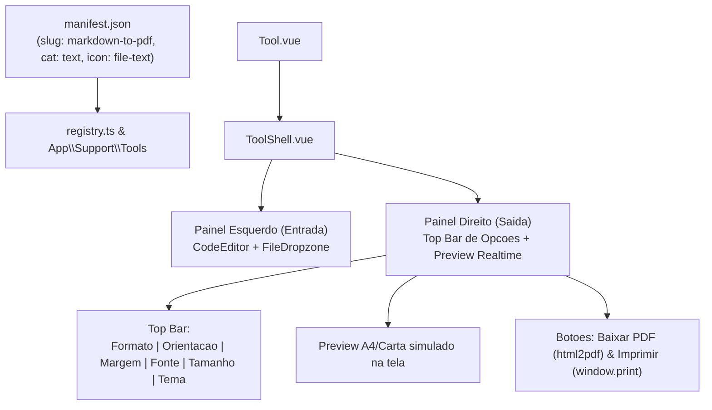

# Plano - Conversor de Markdown para PDF (`markdown-to-pdf`)

Branch: `develop_natan`.
Data: 2026-10-18.
Escopo: Criacao da ferramenta completa de conversao de Markdown para PDF (`markdown-to-pdf`), com entrada de texto e upload de arquivo `.md`/`.txt` a esquerda, preview renderizado em tempo real a direita com aparencia de folha de papel, controles de formato (A4, Carta, A5; Retrato/Paisagem; Margens), fontes (Sans-serif, Serif, Monospace, Fira Code; tamanhos Pequeno, Medio, Grande), padroes de cores (Moderno, Editorial, Minimalista P&B, Academico), botao de download direto do PDF e opcao de impressao nativa com maxima fidelidade vetorial.

---

## 1. Decisoes Alinhadas no Grill com Docs

1. **Mecanismo de Exportacao (Hibrido)**:
   - Botao principal **Baixar PDF** (`Download`): Gera o arquivo `.pdf` no cliente e dispara o download direto (ex.: `documento.pdf`).
   - Opcao **Imprimir / Salvar como PDF** (`Printer`): Abre o dialogo nativo de impressao do navegador (`window.print()`) com folha de estilo dedicada (`@media print`, `@page`), garantindo texto 100% vetorial, fontes nitidas e links clicaveis.
   - Ambas as opcoes rodam 100% no navegador (ADR-002), sem envio de dados ao servidor.

2. **Opcoes de Formato de Pagina**:
   - **Tamanho de Folha**: `A4` (210 x 297 mm, padrao), `Carta / Letter` (8.5 x 11 pol), `A5` (148 x 210 mm).
   - **Orientacao**: `Retrato` (Portrait, padrao) e `Paisagem` (Landscape).
   - **Margens**: `Normal` (20mm, padrao), `Compacta` (10mm) e `Larga` (30mm).

3. **Padroes de Cores (Temas Visuais)**:
   - **Moderno / Clean (GitHub style)**: Tipografia limpa, titulos destacados, blocos de codigo sutis em cinza, tabelas com bordas suaves.
   - **Editorial / Elegante**: Tons marinho profundo (Navy) em titulos, detalhes em carmesim (Crimson), citacoes com barra lateral estilizada.
   - **Minimalista P&B**: Alto contraste, preto e branco puro, sem sombras, otimizado para impressao economica sem desperdicio de toner/tinta.
   - **Academico / Formal**: Espacamento confortavel, cabecalhos sobrios, estilo estruturado para trabalhos e documentacoes tecnicas.

4. **Opcoes de Tipografia e Fontes**:
   - **Familias de Fontes**:
     - *Sans-serif moderna*: Inter / System Sans.
     - *Serif editorial*: Merriweather / Georgia / Serif.
     - *Monospace tecnica*: JetBrains Mono / Courier.
     - *Fira Code*: Com ligaturas e estilizacao de programador.
   - **Tamanho da Fonte**: `Pequeno` (12px / 0.875rem), `Medio` (14px / 1rem, padrao), `Grande` (16px / 1.125rem).

5. **Entrada e Suporte a Markdown**:
   - Suporte completo a GitHub Flavored Markdown (GFM): tabelas, listas de tarefas com checkboxes (`[x]`), tachado (`~~`), citacoes (`>`), divisor horizontal, imagens e blocos de codigo com realce.
   - Sanitizacao estrita de seguranca via `DOMPurify` para neutralizar scripts maliciosos e tags inseguras.
   - Editor CodeMirror 6 no painel esquerdo com realce de sintaxe Markdown via `@codemirror/lang-markdown`.
   - Suporte a arrastar e soltar e abrir arquivo `.md` e `.txt` com `FileDropzone.vue` e `lib/file.ts`.

6. **Registro e Identidade**:
   - Slug: `markdown-to-pdf`.
   - Categoria: `text`.
   - Icone: `file-text` (Lucide `FileText`).
   - Ordem: `90` (apos `regex-tester`, que e 80).
   - Status: `available`.
   - Traducoes completas em 5 idiomas: `pt-BR`, `pt-PT`, `en`, `es`, `fr`.

---

## 2. Arquitetura e Estrutura de Arquivos

### 2.1. Arquivos Criados
1. `resources/js/tools/markdown-to-pdf/manifest.json`: Manifesto oficial da tool.
2. `resources/js/tools/markdown-to-pdf/sample.md`: Exemplo rico e formatado de Markdown para o botao "Exemplo".
3. `resources/js/tools/markdown-to-pdf/lib/types.ts`: Tipos estritos TypeScript para configuracoes de pagina, fontes e temas.
4. `resources/js/tools/markdown-to-pdf/lib/markdown.ts`: Parse de Markdown via `marked` com configuracao GFM e sanitizacao com `DOMPurify`.
5. `resources/js/tools/markdown-to-pdf/lib/themes.ts`: Definicoes CSS e classes Tailwind para cada tema de cores e familia de fontes.
6. `resources/js/tools/markdown-to-pdf/lib/pdf.ts`: Rotinas de geracao de PDF client-side e disparo de impressao nativa isolada.
7. `resources/js/tools/markdown-to-pdf/Tool.vue`: Componente completo da pagina, integrando shell, controles, editor e preview.
8. `resources/js/__tests__/markdown-to-pdf.test.ts`: Testes unitarios do modulo com Vitest.

### 2.2. Arquivos Modificados
1. `package.json`: Adicao de `marked`, `dompurify`, `@types/dompurify`, `@codemirror/lang-markdown`, `html2pdf.js` (ou `jspdf` + `html2canvas`).
2. `resources/js/tools/icons.ts`: Registro do icone `FileText` mapeado para `file-text`.
3. `lang/en/tools.php`, `lang/pt_BR/tools.php`, `lang/pt_PT/tools.php`, `lang/fr/tools.php`, `lang/es/tools.php`: Textos e opcoes traduzidos nos 5 idiomas.
4. `tests/Feature/Tools/ToolsRegistryTest.php`: Atualizacao da lista esperada de tools com `markdown-to-pdf`.
5. `resources/js/__tests__/tools-registry.test.ts`: Atualizacao da lista esperada no frontend.

---

## 3. Fases de Execucao

### Fase 1: Dependencias e Registro da Tool
- Instalar dependencias necessarias via npm.
- Criar `resources/js/tools/markdown-to-pdf/manifest.json`.
- Adicionar `FileText` em `resources/js/tools/icons.ts`.
- Inserir as strings traduzidas em todos os 5 arquivos de traducao `lang/{locale}/tools.php`.
- Atualizar os testes de registro `ToolsRegistryTest.php` e `tools-registry.test.ts`.
- **Verificacao**: `php artisan test --filter ToolsRegistryTest` e `npx vitest run tools-registry`.

### Fase 2: Motor de Parse Markdown, Temas e PDF
- Implementar `resources/js/tools/markdown-to-pdf/lib/types.ts` com enums e interfaces.
- Implementar `resources/js/tools/markdown-to-pdf/lib/markdown.ts` com `marked` e sanitizacao de seguranca `DOMPurify`.
- Implementar `resources/js/tools/markdown-to-pdf/lib/themes.ts` com os 4 padroes de cores e 4 familias de fontes.
- Implementar `resources/js/tools/markdown-to-pdf/lib/pdf.ts` com geracao direta e rotina de impressao vetorial `@media print`.
- Criar `resources/js/tools/markdown-to-pdf/sample.md`.
- **Verificacao**: Testes unitarios isolados dos modulos em `resources/js/__tests__/markdown-to-pdf.test.ts`.

### Fase 3: Interface do Usuario (`Tool.vue`)
- Construir o componente `Tool.vue` consumindo `ToolShell.vue`.
- Painel esquerdo: `CodeEditor.vue` com extensao `@codemirror/lang-markdown`, atalhos de teclado, e `FileDropzone.vue` para `.md` e `.txt`.
- Painel direito (header): Seletores de Formato de folha, Orientacao, Margem, Familia de Fonte, Tamanho de Fonte e Tema de Cores.
- Painel direito (body): Container com simulacao de folha de papel física e estilizacao reativa.
- Barra de acoes: Botoes Exemplo, Abrir, Limpar, Copiar Markdown, Imprimir e Baixar PDF com estado de carregamento/geracao.
- Barra de status: Contagem de caracteres, palavras, bytes e notificacoes de status.
- **Verificacao**: Testes com `@vue/test-utils` no Vitest cobrindo mudanca de opcoes, renderizacao e botoes.

### Fase 4: Qualidade, Validacao e Relatorio
- Executar suite completa do backend: `composer test` (Pint, PHPStan, Pest).
- Executar suite completa do frontend: `npm run test` (Vitest) e `npm run types:check` (vue-tsc).
- Checagem de linters: `npm run lint` e `npm run format`.
- Gerar relatorio detalhado em `docs/gemini/reports/develop_natan/20261018_develop_natan_markdown_to_pdf.md`.
