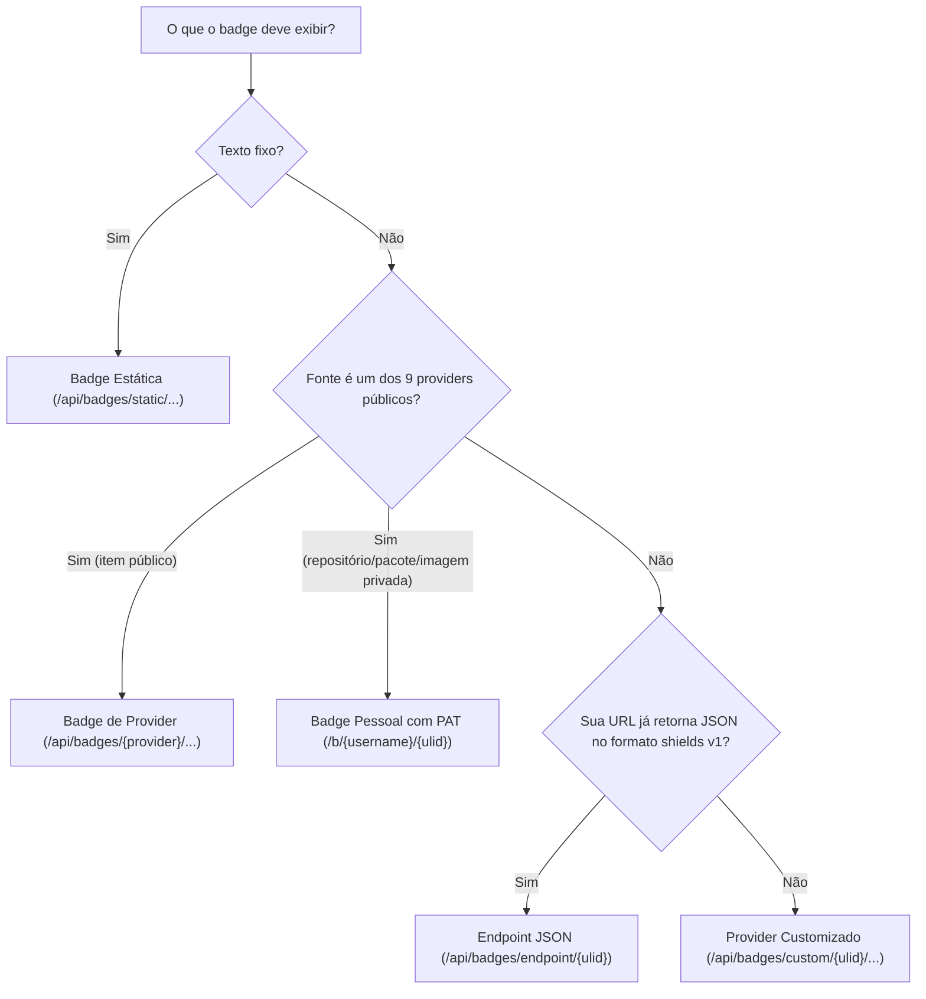

# Tutorial do BadgeForge

O **BadgeForge** é a ferramenta de criação e hospedagem de badges SVG e PNG do **devtools.natanfiuza.dev.br**. Você pode gerar badges estáticas instantaneamente sem login, conectar métricas públicas de GitHub, npm, Packagist, Docker Hub, Codecov, Coveralls, Laravel, PHP e Python, ou usar sua conta para gerenciar logos próprios, endpoints JSON, badges pessoais (inclusive para itens privados), providers customizados e analytics.

> [!NOTE]
> Os exemplos deste guia usam o domínio `https://devtools.natanfiuza.dev.br`. Se você estiver rodando uma instância local ou *self-hosted*, substitua pela `APP_URL` da sua instalação.

## Sumário

1. [Onde acessar e qual tipo de badge escolher](#1-onde-acessar-e-qual-tipo-de-badge-escolher)
2. [Primeiros passos: badge estática (sem login)](#2-primeiros-passos-badge-estática-sem-login)
3. [Badges dinâmicas com Providers públicos](#3-badges-dinâmicas-com-providers-públicos)
4. [Recursos da conta gratuita (Free)](#4-recursos-da-conta-gratuita-free)
5. [Recursos do plano pago](#5-recursos-do-plano-pago)
6. [Automação via API REST v1 (visão rápida)](#6-automação-via-api-rest-v1-visão-rápida)
7. [Solução de problemas comuns](#7-solução-de-problemas-comuns)

---

## 1. Onde acessar e qual tipo de badge escolher

- **Construtor visual**: `/{idioma}/tools/badgeforge` (ex.: `/pt-br/tools/badgeforge`).
- **Painel da sua conta**: `/dashboard/badgeforge` (logos, presets, badges pessoais, endpoints JSON, providers customizados e analytics).
- **Referência pública de rotas e métricas**: `/{idioma}/docs/badgeforge` (link **BadgeForge docs** no rodapé do site).

Use o fluxo abaixo para escolher o tipo ideal para o seu caso:



### Resumo por perfil de conta

| Recurso | Anônimo | Conta gratuita (Free) | Plano pago |
| --- | --- | --- | --- |
| Badge estática e Providers públicos (`SVG`/`PNG`) | Sim | Sim | Sim |
| Logos embutidos, cores, fontes e estilos | Sim | Sim | Sim |
| Logos personalizados (`?logo=u_<ULID>`) | Não | Até 2 | Ilimitado |
| Presets salvos (`?preset=<id>`) | Não | Ilimitado | Ilimitado |
| Endpoint JSON (`/api/badges/endpoint/{ulid}`) | Não | Sim (300 req/min) | Sim (3000 req/min) |
| Badge pessoal (`/b/{username}/{ulid}`) e itens privados | Não | Não | Sim (ilimitado) |
| Provider customizado (`/api/badges/custom/{ulid}/...`) | Não | Não | Sim (até 10) |
| Analytics de visualizações | Não | 30 dias | 7 / 30 / 90 dias + CSV |

---

## 2. Primeiros passos: badge estática (sem login)

Badges estáticas são ideais para status fixos em `README.md`, documentação ou portfólio (ex.: `build | passing`, `licença | MIT`, `versão | 1.0.0`). Enquanto você digita no construtor, a prévia é montada **100% no navegador** — nada vai ao servidor até que alguém acesse a URL copiada.

### Passo a passo pela interface

1. Acesse `/{idioma}/tools/badgeforge` na aba **Estática**.
2. Em **Conteúdo**, preencha **Rótulo** (lado esquerdo, ex.: `build`), **Mensagem** (lado direito, ex.: `passing`) e escolha o **Estilo**:
   - `flat` (padrão)
   - `flat-square`
   - `plastic`
   - `for-the-badge`
   - `social` *(fixa suas próprias cores `#555555` e `#007ec6`; `Cor` e `Cor do rótulo` são ignorados)*
3. Em **Cores**, ajuste **Cor** e **Cor do rótulo** usando os atalhos da paleta ou digitando qualquer cor CSS válida (nome CSS como `brightgreen`, hex `#44cc11`, `rgb()`, `rgba()`, `hsl()`, `hsla()` ou `transparent`).
4. Em **Logo**, selecione um **Logo** embutido (ou `Sem logo`) e ajuste **Cor do logo**, **Tamanho do logo** (8 a 20 px) e **Posição do logo** (`Esquerda` ou `Direita`).
5. Em **Avançado**, configure opcionalmente:
   - **Link**: URL `http` ou `https` clicável no SVG.
   - **Cache (segundos)**: tempo de cache entre `300` e `86400` s (padrão `86400`).
   - **Fonte**: `Padrão do estilo`, `Fira Code`, `Libre Franklin` ou `Space Grotesk`.
   - **Formato**: `SVG` ou `PNG`.
6. Na coluna direita (**Prévia**), alterne entre **Fundo claro** e **Fundo escuro** para conferir o contraste. Se quiser testar rápido, use os botões **Exemplo** ou **Limpar**.
7. Em **Incorporar**, escolha a aba **Markdown**, **HTML**, **reStructuredText** ou **URL** e clique para copiar, ou baixe a imagem diretamente.

### Anatomia da URL estática

```text
GET https://devtools.natanfiuza.dev.br/api/badges/static/{label}/{message}.{svg|png}
```

Regras importantes do caminho:

- `_` vira espaço; `__` vira `_` literal; `-` e `.` são literais.
- Para usar barra (`/`) dentro de `label` ou `message`, use dupla codificação `%252F` (ex.: `ci%252Fcd`).
- Textos acima de 100 caracteres são truncados com `…`.
- A extensão no final é obrigatória e deve ser `.svg` ou `.png` (nunca `.svg.png`).

Exemplos prontos para copiar no seu `README.md`:

```markdown


```

> [!TIP]
> Para forçar o download da imagem como anexo no navegador, adicione `?download=1` na URL.

---

## 3. Badges dinâmicas com Providers públicos

Quando você quer exibir dados em tempo real de repositórios, pacotes ou versões de runtime públicos, use a aba **Provider** no construtor.

### Passo a passo pela interface

1. Na tela do BadgeForge, mude para a aba **Provider**.
2. Escolha o **Provider** e a métrica (**Definição**).
3. Informe o **Caminho (`path`)** no formato esperado (ex.: `laravel/framework`) — para runtimes (`laravel`, `php`, `python`), o campo já usa `latest`.
4. Personalize estilo, cores, logo, fonte e formato normalmente e copie o snippet na seção **Incorporar**.

### Providers e métricas disponíveis

| Provider | Definição | Formato do `path` | Exemplo |
| --- | --- | --- | --- |
| `github` | `stars`, `forks`, `issues`, `license` | `owner/repo` | `/api/badges/github/stars/natanfiuza/devtools.svg` |
| `npm` | `v` (versão), `dm` (downloads/mês) | `package` | `/api/badges/npm/v/laravel.svg` |
| `packagist` | `dt` (downloads totais), `v` (versão) | `vendor/package` | `/api/badges/packagist/dt/laravel/framework.svg` |
| `docker` | `pulls` | `namespace/repository` | `/api/badges/docker/pulls/library/nginx.svg` |
| `codecov` | `coverage` | `owner/repo` | `/api/badges/codecov/coverage/psf/requests.svg` |
| `coveralls` | `coverage` | `owner/repo` | `/api/badges/coveralls/coverage/twbs/bootstrap.svg` |
| `laravel` | `v`, `dt` | `latest` | `/api/badges/laravel/v/latest.svg` |
| `php` | `v` | `latest` | `/api/badges/php/v/latest.svg` |
| `python` | `v` | `latest` | `/api/badges/python/v/latest.svg` |

**Comportamento de cache e falhas:**

- As consultas públicas são **anônimas** e cacheadas por **300 segundos** no servidor. Os parâmetros `?cacheSeconds=` e `?refresh=1` são ignorados nessa rota.
- Se o provider externo falhar, der timeout ou atingir rate limit (`429`), o BadgeForge serve o último valor bom em cache (*stale-if-error*) ou um badge `200` com `unavailable` — sua página nunca recebe erro `500`.

---

## 4. Recursos da conta gratuita (Free)

Ao entrar com sua conta, você desbloqueia recursos de organização e integração no construtor e em `/dashboard/badgeforge`:

### 4.1 Logos personalizados (`Meus logos`)

- **Limite**: até **2** logos na conta Free (ilimitado no plano pago).
- **Como enviar**: clique em **Meus logos** no construtor ou acesse `/dashboard/badgeforge` e envie um arquivo `.svg` (máximo de 256 KiB).
- **Sanitização**: por segurança, apenas `<svg>`, `<g>`, `<path>` e primitivas vetoriais simples (`<rect>`, `<circle>`, `<ellipse>`, `<polygon>`, `<polyline>`, `<line>`, convertidas para `<path>`) são aceitos; metadados benignos (`<title>`, `<desc>`, `<metadata>`) são ignorados e o arquivo bruto nunca fica armazenado. Elementos como `<text>`, `<style>`, `<defs>`, `<image>`, `<use>` ou `<script>` e atributos como `transform` são recusados.
- **Como usar na URL**: o logo recebe um identificador opaco `u_<ULID>` (ex.: `?logo=u_01J...`). Badges com logo personalizado têm teto de cache de **3600 s** (1 hora), garantindo que renomeações ou exclusões reflitam rapidamente.

### 4.2 Presets (`Presets`)

- **Limite**: ilimitado em contas gratuitas e pagas.
- **Como usar**: após montar um visual padrão para os seus projetos (estilo, cores, fonte, logo), clique em **Presets** para salvar um snapshot do formulário.
- Para reabrir o formulário preenchido depois, aplique pelo menu **Presets** ou acesse `/{idioma}/tools/badgeforge?preset=<ULID>`.

### 4.3 Endpoint JSON (`/api/badges/endpoint/{ulid}.{svg|png}`)

Permite gerar um badge dinâmico a partir de qualquer endpoint **HTTPS** seu que devolva JSON no contrato **shields v1**, sem expor a URL de origem no `README.md`.

1. Acesse `/dashboard/badgeforge` e cadastre um novo **Endpoint JSON** informando **Nome** e **URL de origem**.
2. Sua URL de origem precisa responder com `Content-Type: application/json` e este formato:

```json
{
  "schemaVersion": 1,
  "label": "deploy",
  "message": "ok",
  "color": "brightgreen",
  "labelColor": "555555"
}
```

- `schemaVersion` deve ser `1`; `label` e `message` são obrigatórios e não vazios; `color` e `labelColor` são opcionais (parâmetros `?color=` e `?labelColor=` na URL da imagem têm prioridade).
- **Requisitos de rede (proteção SSRF)**: HTTPS obrigatório na porta `443`, sem *redirects*, sem credenciais na URL e apenas IPs públicos.
- **URL pública**: `https://devtools.natanfiuza.dev.br/api/badges/endpoint/{ulid}.svg` (aceita os mesmos parâmetros cosméticos: `style`, `color`, `labelColor`, `logo`, `font`, etc.; `cacheSeconds` e `refresh` são ignorados pois o TTL é fixo em `300 s`).
- **Rate limit por dono**: `300 req/min` no Free e `3000 req/min` no plano pago.

### 4.4 Analytics básico

Em `/dashboard/badgeforge`, contas gratuitas acompanham as visualizações dos últimos **30 dias** para badges com dono (Endpoint JSON, e também badges pessoais ou providers customizados caso tenha tido plano pago anteriormente).

---

## 5. Recursos do plano pago

### 5.1 Badges pessoais (`/b/{username}/{ulid}.{svg|png}`) e itens privados

Uma **badge pessoal** fixa as configurações (e, quando aplicável, uma credencial) em uma URL curta e opaca:

```text
https://devtools.natanfiuza.dev.br/b/{username}/{ulid}.svg
```

- **Quando usar**: sempre que você quiser consultar um **repositório privado no GitHub**, **pacote privado no npm** (`npm/v`) ou **imagem privada no Docker Hub** (`docker/pulls`), ou simplesmente querer uma URL curta permanente.
- **Segurança da credencial**: o PAT (*Personal Access Token*) é informado por badge no construtor/painel, armazenado **cifrado** no servidor e **nunca** aparece na URL pública, logs ou exportações.
- **Atualização manual (*refresh*)**: diferente das rotas públicas, você pode forçar a regeneração da sua badge pessoal pelo painel (botão de atualizar / `POST /badgeforge/badges/{ulid}/refresh`, com limite de 10 req/min).

Para criar tokens com o menor privilégio possível antes de colar no BadgeForge, siga o guia específico do provider:

- [PAT do GitHub para badge de repositório privado](github-token.md)
- [Token do npm para badge de pacote privado](npm-token.md)
- [PAT do Docker Hub para badge de imagem privada](docker-token.md)

> [!NOTE]
> Se houver downgrade para o plano Free, suas badges pessoais existentes continuam sendo servidas normalmente e podem ser copiadas ou excluídas, mas criação, renomeação, troca de token e refresh ficam bloqueados.

### 5.2 Providers customizados (`/api/badges/custom/{ulid}/{definition}/{path}.{svg|png}`)

Se você consome uma API JSON que **não** segue o formato shields v1, um **Provider customizado** extrai valores diretamente do JSON usando **JSON Pointer (RFC 6901)** — sem expor o template da URL de origem.

1. Em `/dashboard/badgeforge` (limite padrão de **10** providers customizados por conta paga), crie um novo provider informando:
   - **Nome** do provider;
   - **Template de URL HTTPS** com placeholders no path (ex.: `https://api.exemplo.com/v1/repos/{owner}/{repo}`);
   - **Exemplo de path (`example_path`)** concreto (ex.: `minha-org/meu-app`) para validação inicial no cadastro;
   - **Métricas** (até 10 por provider): cada uma com `slug`, `label`, **JSON Pointer** (ex.: `/metrics/coverage` ou `/version`) e **formatador**:
     - `text`: texto normalizado;
     - `number`: formatação numérica compacta (`k`, `M`, `B`);
     - `percent`: percentual inteiro (`0` a `100`).
2. Após criado, o provider aparece na aba **Customizado** do construtor visual para montar e copiar as URLs no formato:

```text
https://devtools.natanfiuza.dev.br/api/badges/custom/{ulid}/{definition}/{path}.svg
```

> [!IMPORTANT]
> O template da URL e o conjunto de métricas são **imutáveis** após a criação (para alterá-los, exclua e recrie o provider). Já o nome do provider e o `label`, `pointer` e `formatter` de cada métrica podem ser editados a qualquer momento.

### 5.3 Analytics completo e exportação CSV

No painel `/dashboard/badgeforge`, usuários pagos têm acesso a:

- Janelas de **7, 30 e 90 dias**;
- Série diária de visualizações, top *referrers*, países, distribuição por formato (`svg`/`png`) e taxa de acerto de cache;
- **Exportação em CSV** do período (sem dados pessoais como IP ou User-Agent bruto).

---

## 6. Automação via API REST v1 (visão rápida)

Tudo o que você faz no painel `/dashboard/badgeforge` também pode ser automatizado via API REST usando um token de API gerado em `/settings/api-tokens` com os escopos `badgeforge:read` e `badgeforge:write`.

Exemplo listando suas badges pessoais:

```bash
curl -sS \
  -H "Authorization: Bearer SEU_TOKEN_AQUI" \
  -H "Accept: application/json" \
  "https://devtools.natanfiuza.dev.br/api/v1/badgeforge/badges"
```

Para consultar todos os endpoints, parâmetros, códigos de erro e payloads:

- Contrato completo em prosa: [API.md](../badgeforge/API.md)
- Guia da especificação OpenAPI: [OPENAPI.md](../badgeforge/OPENAPI.md)
- Especificação OpenAPI 3.1.0 (máquina): `GET /openapi/badges.yaml` (ou [openapi.yaml](../badgeforge/openapi.yaml))

---

## 7. Solução de problemas comuns

| Sintoma | Causa provável | Como resolver |
| --- | --- | --- |
| Texto com `/` no badge estático retorna `404` | Barra simples quebra o roteamento de path | Use `%252F` no lugar de `/` (ex.: `ci%252Fcd`) |
| `color` e `labelColor` não mudam no estilo `social` | O estilo `social` fixa suas próprias cores por design | Escolha `flat`, `flat-square`, `plastic` ou `for-the-badge` |
| Logo personalizado (`u_<ULID>`) sumiu e retornou `200` sem logo | Logo foi excluído, ULID inválido ou SVG fora do padrão | Confira o ULID em **Meus logos** e aguarde até 1 h de cache |
| Badge de provider ou endpoint mostra `unavailable` | Origem externa fora do ar, timeout ou sem resposta prévia em cache | Verifique se a URL/repositório existe e aguarde a expiração do fallback (60 s) |
| Erro `422` ao salvar Endpoint JSON | URL não usa HTTPS na porta 443, faz redirect, aponta para IP privado (SSRF) ou JSON foge do contrato `schemaVersion: 1` | Garanta HTTPS direto na porta 443 retornando `Content-Type: application/json` válido |
| Requisição `.png` retorna `503 image_unavailable` | Ambiente self-hosted sem extensão PHP `imagick` | Instale o ImageMagick/Imagick seguindo [instalar-imagick-ubuntu.md](instalar-imagick-ubuntu.md) |
